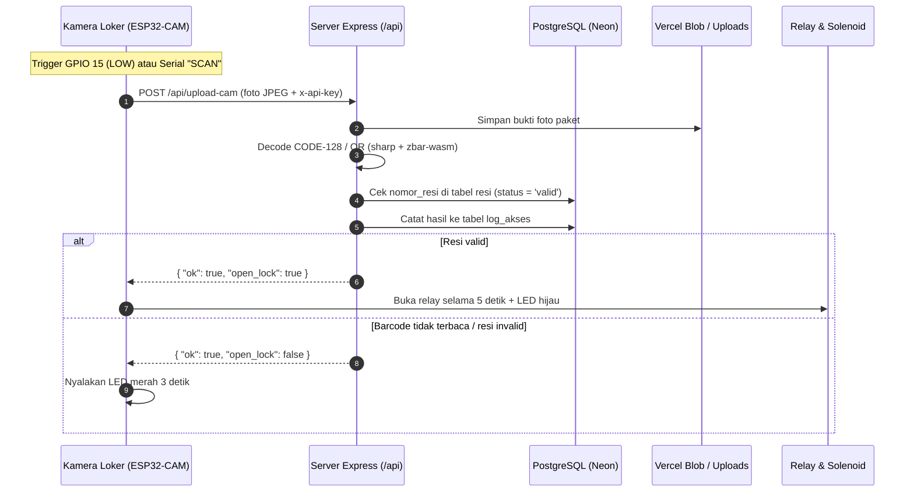
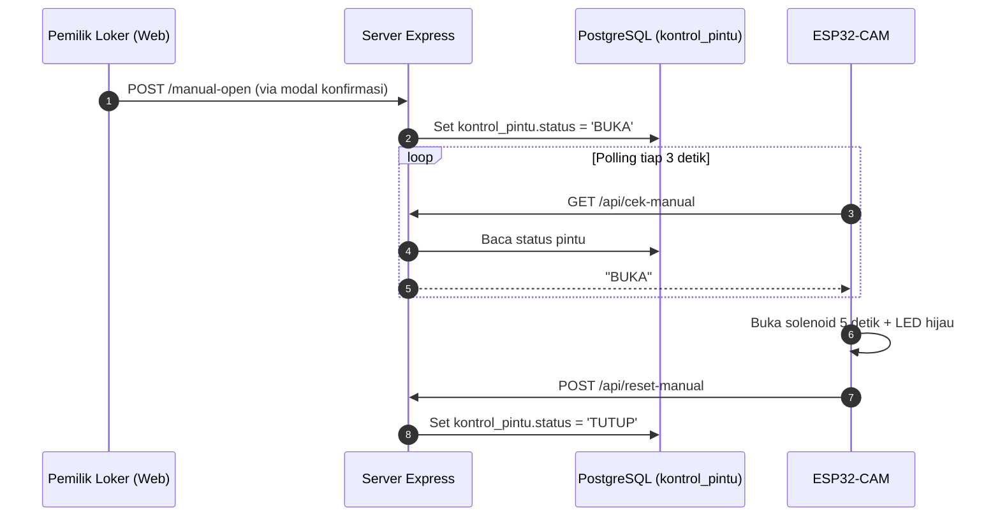

<div align="center">
  
  <h1>Smart Drop Locker</h1>
  <p>
    Sistem loker paket pintar berbasis kamera IoT (ESP32-CAM) dan dashboard web untuk memverifikasi nomor resi, mencatat bukti foto, dan mengontrol kunci pintu loker.
  </p>

  <p>
    
    
    
    
  </p>

  <p>
    <a href="#alur-kerja-sistem">Alur Kerja</a> &middot;
    <a href="#fitur-dashboard">Fitur Dashboard</a> &middot;
    <a href="#panduan-instalasi--deploy">Instalasi &amp; Deploy</a> &middot;
    <a href="#setup-hardware-esp32-cam">Hardware ESP32-CAM</a> &middot;
    <a href="#referensi-api--database">API &amp; Database</a>
  </p>
</div>

---

## Alur Kerja Sistem

Loker bekerja dalam dua jalur utama: pemindaian barcode paket langsung dari kamera loker, dan pembukaan pintu jarak jauh dari dashboard.



<details>
<summary><strong>Lihat alur kontrol buka pintu manual dari dashboard</strong></summary>



</details>

---

## Fitur Dashboard

| Halaman | Rute | Fungsi Utama |
| :--- | :--- | :--- |
| **Dashboard** | `/` | Pantau status kunci pintu, ringkasan resi dan scan hari ini, buka pintu manual via modal konfirmasi, serta pratinjau foto log terbaru. |
| **Data Resi** | `/resi` | Cari resi secara langsung tanpa reload halaman, ubah status `Valid` / `Invalid`, atau hapus resi. |
| **Tambah & Edit Resi** | `/resi/add`, `/resi/:id` | Daftarkan nomor resi baru beserta nama paket dan status akses, atau perbarui data resi yang sudah ada. |
| **Log Akses** | `/log` | Filter riwayat pemindaian berdasarkan nomor resi dan status (`Berhasil` / `Gagal`), lihat bukti foto ukuran penuh, dan hapus log beserta file fotonya. |
| **Scan Manual** | `/scan` | Unggah foto barcode (JPG/PNG) dengan pratinjau gambar langsung untuk menguji pembacaan dan validasi tanpa perangkat fisik. |

- **Tema Gelap & Terang**: Tersedia tombol toggle tema di header yang tersimpan di `localStorage`.
- **Navigasi Interaktif**: Perpindahan antar halaman berjalan tanpa reload penuh dengan transisi terarah, serta drawer navigasi khusus untuk layar mobile.

---

## Panduan Instalasi & Deploy

Pilih panduan yang sesuai dengan kebutuhanmu untuk membuka langkah lengkapnya:

<details open>
<summary><strong>1. Setup Lokal (Development)</strong></summary>

1. **Install dependensi**:
   ```bash
   npm install
   ```
2. **Siapkan environment**:
   Salin `.env.example` menjadi `.env`:
   ```bash
   cp .env.example .env
   ```
   Isi `DATABASE_URL` (dan `DATABASE_URL_UNPOOLED` jika memakai Neon) serta `ESP32_API_KEY`.
   > Catatan: `BLOB_READ_WRITE_TOKEN` boleh dikosongkan saat berjalan di localhost; foto bukti akan disimpan otomatis ke `public/uploads/`.
3. **Jalankan migrasi skema database**:
   ```bash
   npm run db:migrate
   ```
   Perintah ini menjalankan `schema.sql` memakai koneksi direct (`DATABASE_URL_UNPOOLED` jika tersedia) untuk membuat tabel `resi`, `log_akses`, dan `kontrol_pintu`.
4. **Jalankan server development**:
   ```bash
   npm run dev
   ```
   Buka `http://localhost:3000`.
5. **Cek sintaks proyek**:
   ```bash
   npm run check
   ```

</details>

<details>
<summary><strong>2. Deploy ke Vercel + Vercel Blob Storage</strong></summary>

1. Push repository ini ke GitHub/GitLab/Bitbucket, lalu import project di **Vercel**.
2. Aktifkan **Vercel Blob Storage** pada tab **Storage** di dashboard project Vercel (ini mengisi `BLOB_READ_WRITE_TOKEN` secara otomatis).
3. Tambahkan **Environment Variables** berikut di pengaturan project Vercel:
   - `DATABASE_URL`: connection string PostgreSQL pooled (Neon / Supabase).
   - `ESP32_API_KEY`: token rahasia untuk autentikasi request dari ESP32-CAM.
4. Deploy. Konfigurasi di `vercel.json` otomatis membundel template `views/**` serta binary WASM `zbar.wasm` ke serverless function `api/index.js`.

</details>

---

## Setup Hardware ESP32-CAM

<details>
<summary><strong>Lihat konfigurasi firmware, pinout AI Thinker, dan cara trigger scan</strong></summary>

### Langkah Upload Firmware
1. Buka `firmware/esp32_cam/esp32_cam.ino` di **Arduino IDE** (target board: **AI Thinker ESP32-CAM**).
2. Salin `firmware/esp32_cam/secrets.example.h` menjadi `firmware/esp32_cam/secrets.h`, lalu isi:
   - `WIFI_SSID` & `WIFI_PASS`
   - `BASE_URL` (contoh: `https://project-anda.vercel.app`)
   - `ESP32_API_KEY` (samakan dengan environment variable server)
3. Upload sketch ke board.

### Pemetaan Pin Tambahan
| Fungsi | Pin ESP32-CAM | Keterangan |
| :--- | :--- | :--- |
| **Relay Solenoid** | `GPIO 13` | Aktif `LOW` selama 5 detik saat membuka loker |
| **LED Merah** | `GPIO 12` | Menyala 3 detik saat barcode gagal / resi invalid |
| **LED Hijau** | `GPIO 14` | Menyala saat pintu loker terbuka |
| **Trigger Scan (Tombol/Sensor)** | `GPIO 15` | `INPUT_PULLUP` aktif `LOW` ke `GND` (debounce 50ms, cooldown 3 detik) |

### Cara Memicu Scan
- **Boot awal**: Mengambil 1 foto otomatis saat perangkat menyala (`SCAN_ON_BOOT = true`).
- **Tombol / Sensor fisik**: Hubungkan tombol atau sensor aktif-LOW ke `GPIO 15` dan `GND`.
- **Serial Monitor**: Buka Serial Monitor pada baud rate `115200` lalu kirim perintah `SCAN`.
- **Auto-Reconnect**: Jika koneksi WiFi terputus, firmware otomatis mencoba menyambung ulang setiap 10 detik.

</details>

---

## Referensi API & Database

<details>
<summary><strong>Endpoint API, contoh uji curl, dan skema tabel PostgreSQL</strong></summary>

### Endpoint API (`/api/*`)
Semua endpoint API memeriksa header `x-api-key` (atau query `?key=`) jika `ESP32_API_KEY` diatur.

| Method & Path | Input | Output / Fungsi |
| :--- | :--- | :--- |
| `POST /api/upload-cam` | `multipart/form-data` field `foto` | Simpan foto, decode barcode, cek `resi`, catat `log_akses`, balas `{ ok, resi, status, pesan, open_lock, foto_path }` |
| `POST /api/manual-open` | - | Set `kontrol_pintu.status = 'BUKA'` |
| `GET /api/cek-manual` | - | Balas teks polos `BUKA` atau `TUTUP` |
| `POST /api/reset-manual` | - | Set `kontrol_pintu.status = 'TUTUP'`, balas `RESET` |

Contoh uji endpoint upload tanpa perangkat fisik:
```bash
curl -X POST http://localhost:3000/api/upload-cam \
  -H "x-api-key: ganti-dengan-token-rahasia-esp32" \
  -F "foto=@contoh-resi.jpg"
```

### Skema Tabel (`schema.sql`)
- `resi`: menyimpan `nomor_resi` (unik), `nama_paket`, `status` (`valid` / `invalid`), dan `created_at`.
- `log_akses`: menyimpan riwayat `nomor_resi`, `status` (`berhasil` / `gagal`), `pesan`, `foto_path`, dan `created_at`.
- `kontrol_pintu`: menyimpan status perintah buka pintu manual (`BUKA` / `TUTUP`) pada baris `id = 1`.

</details>

<details>
<summary><strong>Struktur Folder Proyek & Dokumentasi Teknis</strong></summary>

```text
Smart-Drop-Locker/
├── api/index.js                  # Entry point serverless Vercel
├── firmware/esp32_cam/           # Sketch ESP32-CAM & template secrets.example.h
├── public/
│   ├── css/style.css             # Tema gelap/terang & komponen UI
│   ├── img/                      # Logo transparan & favicon
│   └── uploads/                  # Penyimpanan foto fallback lokal
├── src/
│   ├── app.js                    # Konfigurasi Express & error handler
│   ├── db/                       # Pool PostgreSQL (index.js) & migrasi (migrate.js)
│   ├── lib/                      # Barcode decoder, storage adapter, validasi resi
│   └── routes/                   # Route API (/api/*) & Web SSR (/)
├── views/                        # Template EJS (dashboard, resi, log, scan, partials)
├── docs/                         # Catatan analisis & riwayat migrasi
├── DESIGN.md                     # Pedoman visual & motion UI
├── schema.sql                    # Skema PostgreSQL
├── server.js                     # Entry point server lokal
└── vercel.json                   # Routing & bundling Vercel
```

Dokumentasi arsitektur dan riwayat migrasi lengkap tersedia di [docs/README.md](docs/README.md).

</details>
